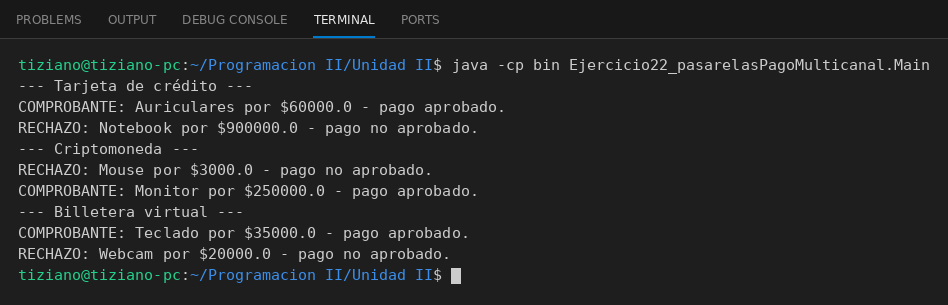

# ProcesadorPago

Programación II - Unidad 2 - Ejercicio 22

## Consigna
Un módulo de compras cobra a través de una interfaz común, cambiando de proveedor de pago dinámicamente.

## Lógica
- Interfaz `ProcesadorPago` con `boolean procesarPago(double)`.
- `PagoTarjetaCredito` (límite disponible), `PagoCriptomoneda` (monto mínimo) y `PagoBilleteraVirtual` (saldo) aplican su propia validación.
- `ModuloCompras` guarda una referencia a la interfaz y `setProcesador` permite cambiarla en tiempo de ejecución.
- `Main`: compras aprobadas y rechazadas con los tres medios.

## Ejecución

